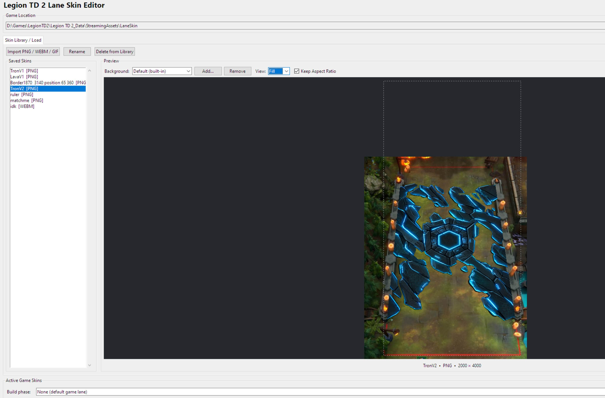

# Ltd2Skinpreview AI MADE (ofc)
# Legion Lane Editor

A simple Python GUI for creating, previewing, managing, and installing custom lane skins for **Legion TD 2**.

Supports PNG, GIF, and WebM files, with automatic conversion and installation.

## Features

- **PNG, GIF & WebM support** — Import static or animated skins.
- **Animated previews** — Preview GIFs and WebMs directly in the editor.
- **Zoom & Pan** — Mouse-wheel zoom and click-and-drag preview navigation.
- **Custom backgrounds** — Preview skins against screenshots from the game.
- **Background calibration** — Adjust size, position, and perspective, with settings saved per background.
- **Skin library** — Save, rename, and manage imported skins.
- **Per-skin settings** — Choose Fit/Fill and aspect ratio independently for each skin.
- **Automatic conversion** — Export PNGs at 2000×4000 and animated WebMs at 1000×2000.
- **Build & Battle skins** — Select different skins for each phase.
- **One-click installation** — Automatically installs selected skins into the Legion TD 2 directory.

## Requirements

- Windows
- Python 3.10+
- Pillow (`pip install pillow`)
- FFmpeg installed and available in PATH for GIF/WebM conversion and WebM previews

## Getting Started

1. Download `LegionLaneEditor_v3_7_6.py`.
2. Install Pillow using `pip install pillow`.
3. Install FFmpeg if using animated skins.
4. Run the script with Python.
5. Select your Legion TD 2 installation folder if it isn't detected automatically.
6. Import a skin, adjust its settings, and click **Save Skin Settings**.
7. Choose your Build and/or Battle skin and click **Apply Skins**.

## Notes

- Imported skins and settings are stored in `%APPDATA%\LegionLaneEditor`.
- Original imported files are never modified during conversion.
- Background calibration affects the editor preview only, not exported skins.
- Animated WebM support may vary depending on the source file and transparency encoding.
- This is an unofficial community tool and is not affiliated with Legion TD 2 or its developers.

## License

No license specified yet.
